# MOFChat - deep-learning classification, learning curves and feature extraction

_Generated by `python evaluate_dl.py` on 2026-10-22 17:52. Figures in `artifacts/dl_eval/`._

MOFChat's property models are regressors (surface area, void fraction); their results are in [RESULTS.md](RESULTS.md). This file adds the classification tasks the project contains, with accuracy, ROC-AUC and confusion matrices, plus learning curves and feature-extraction graphs.

## A. Open-metal-site classification (deep learning vs baselines)

Task: Has_OMS from 10 geometric descriptors + primary metal. Stratified split train 8414 / val 1803 / test 1803; 66.4% of MOFs have an open metal site.

| Model | Accuracy | Precision | Recall | F1 | ROC-AUC | PR-AUC | Train / val / test acc |
|---|---:|---:|---:|---:|---:|---:|---|
| MLP | 0.734 | 0.759 | 0.878 | 0.814 | 0.756 | 0.847 | 0.782 / 0.755 / 0.734 |
| FT-Transformer | 0.728 | 0.755 | 0.873 | 0.810 | 0.755 | 0.852 | 0.781 / 0.735 / 0.728 |
| Majority baseline | 0.663 | 0.663 | 1.000 | 0.798 | 0.500 | 0.663 | - |
| Logistic regression | 0.693 | 0.708 | 0.916 | 0.798 | 0.676 | 0.804 | 0.705 / 0.699 / 0.693 |
| XGBoost | 0.750 | 0.765 | 0.901 | 0.827 | 0.787 | 0.871 | 0.868 / 0.770 / 0.750 |

FT-Transformer classifier: 104,449 parameters, best epoch 31, 96.4 s.

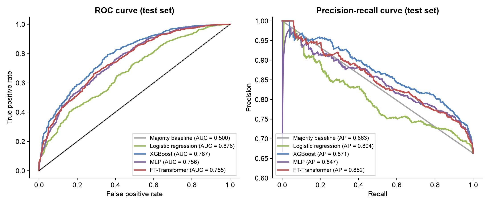
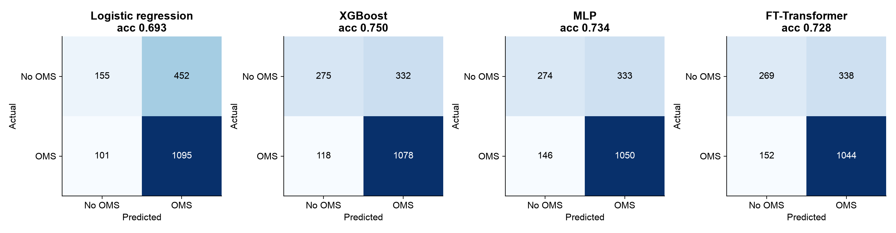
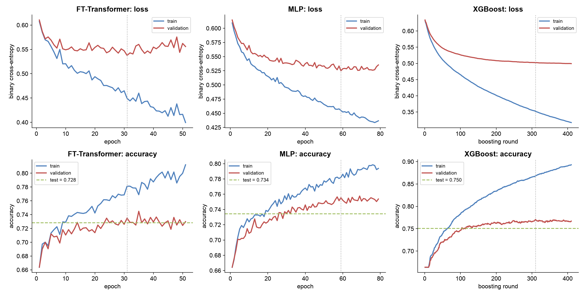

## B. Intent classification by the planner (84 benchmark questions)

| Planner | Intent accuracy | Macro F1 | Exact plan |
|---|---:|---:|---:|
| Rules planner (no LLM) | 0.964 | 0.950 | 0.952 |
| Gemini 3.1 Flash-Lite, alone | 0.833 | 0.870 | 0.845 |
| Gemini 3.1 Flash-Lite, hybrid | 0.988 | 0.952 | 1.000 |
| GPT-OSS 120B, alone | 0.988 | 0.990 | 0.976 |
| GPT-OSS 120B, hybrid | 0.988 | 0.990 | 0.976 |
| Qwen 3.8 27B, alone | 0.976 | 0.942 | 0.976 |
| Qwen 3.8 27B, hybrid | 0.976 | 0.942 | 0.976 |
| Llama 3 8B (local), alone | 0.893 | 0.802 | 0.810 |
| Llama 3 8B (local), hybrid | 0.988 | 0.990 | 0.929 |

Plans that failed at the provider (rate limit or overload) count as wrong (intent "failed"); Gemini 3.1 Flash-Lite alone had 13 such failures in the development run, which the hybrid planner absorbs.

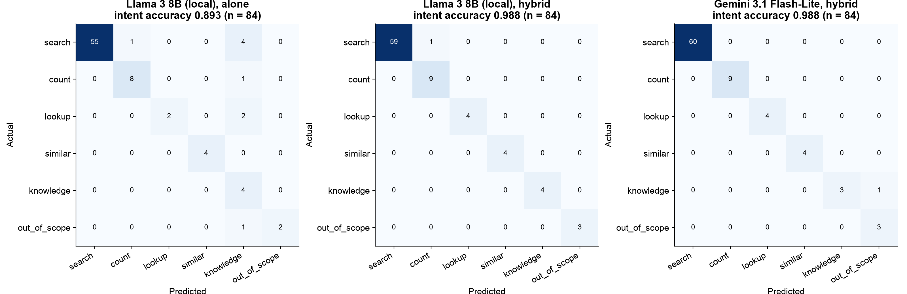

## C. Off-topic detection (knowledge retriever)

91 MOF questions vs 20 off-topic questions (5 original off-topic questions + 15 added for this analysis; threshold fixed beforehand): ROC-AUC 0.981, accuracy 0.955 at cosine threshold 0.3.

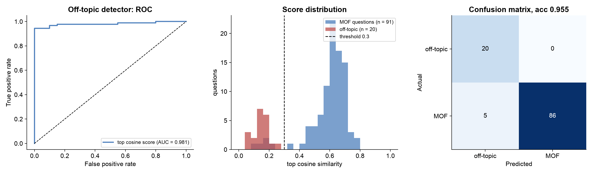

## D. Physics rule as a classifier

Accessible vs zero surface area from PLD ≥ 3.3107 Å: test accuracy 1.0000 on 1202 MOFs.

## E. Regression: train / validation / test

| Target | XGBoost R² train / val / test | FT-Transformer R² train / val / test (accessible) | FT epochs (best) |
|---|---|---|---|
| Surface_Area | 0.987 / 0.959 / 0.972 | 0.975 / 0.969 / 0.972 | 163 (138) |
| Void_Fraction | 0.899 / 0.820 / 0.828 | 0.825 / 0.811 / 0.823 | 120 (95) |

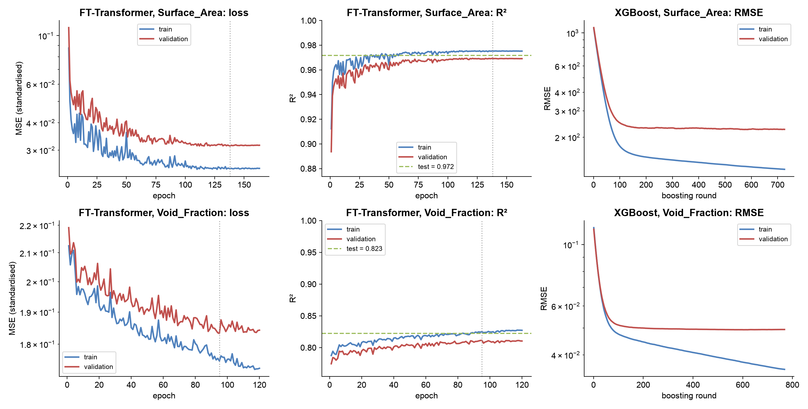

## F. Feature extraction

PCA: the first two components explain 78% of the variance. Strongest correlations: LCD-LFPD +0.99; Surface_Area-Void_Fraction +0.88; Surface_Area-ASA_vol +0.86; PLD-LFPD +0.83; LCD-PLD +0.82.

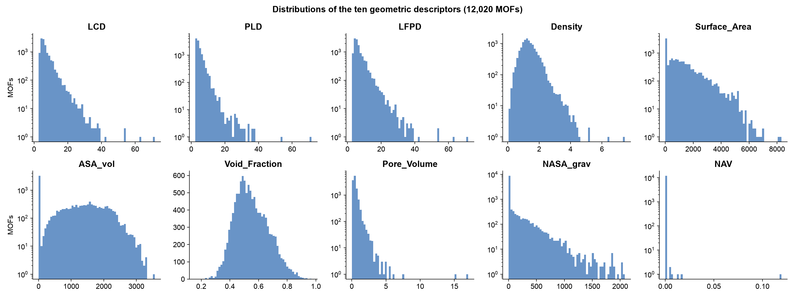
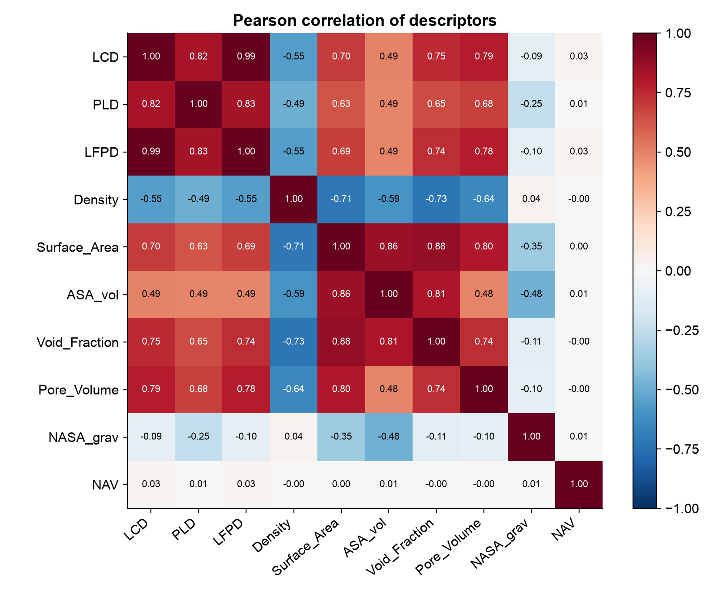
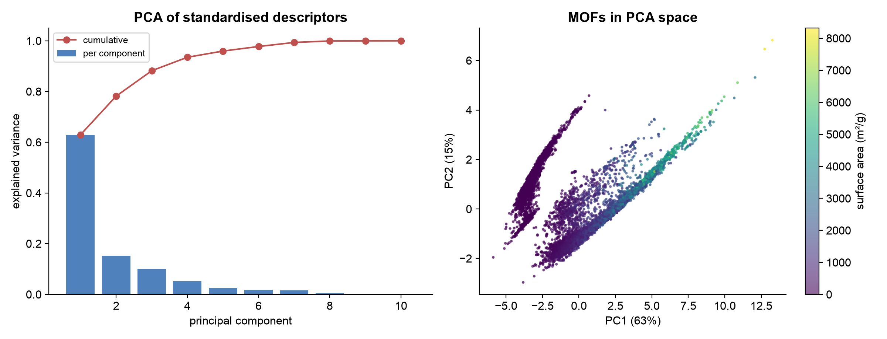
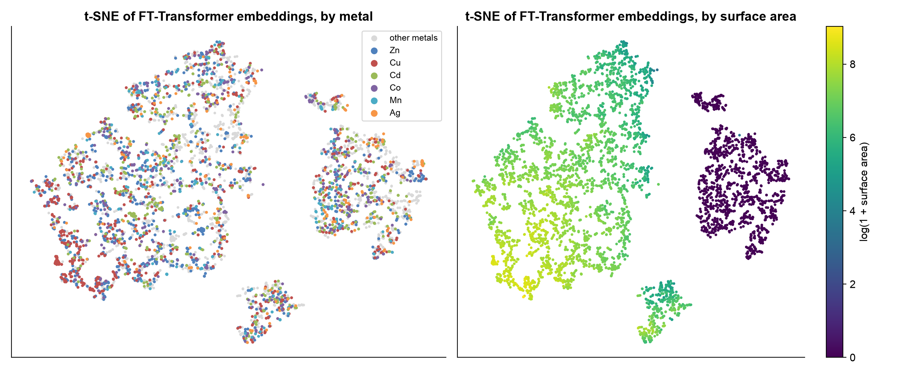
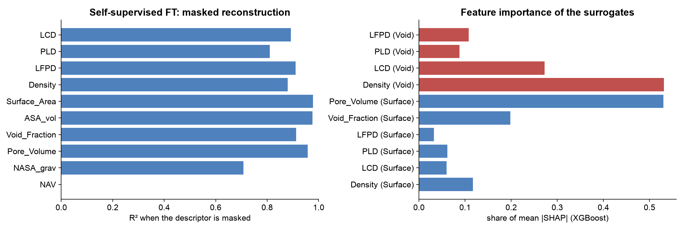
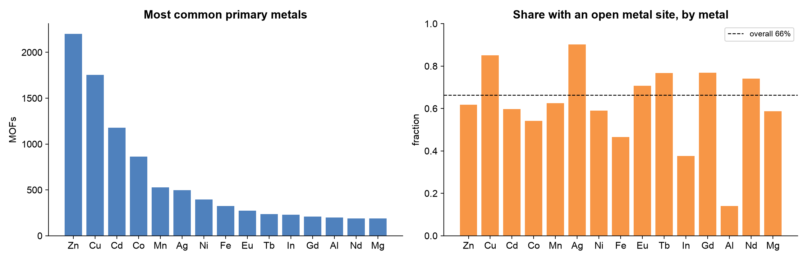
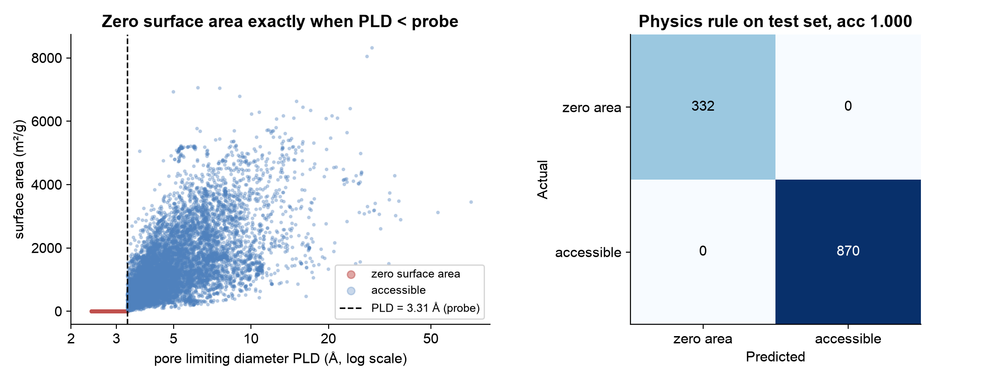
