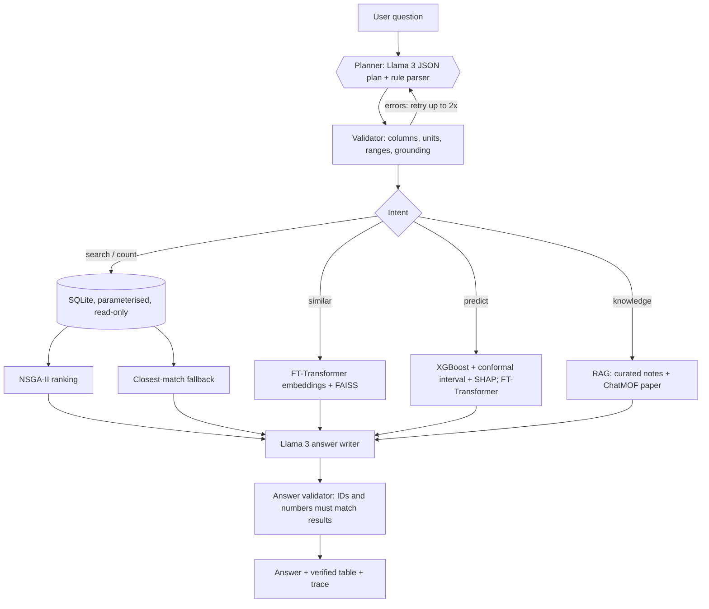

# MOFChat: Explainable, Data-Grounded Metal-Organic Framework Recommendation with Validated LLM Planning, Multi-Objective Optimisation and Surrogate Models

**22AIE452 Data Driven Material Modeling and Simulation · Team 09**
Amrutha T (24255) · Charan Tej Reddy Y (24259) · Poojitha D (24263) · Enku Sai Mohith (24316) · Ramu Jahna Bindu (24249)

## Abstract

Selecting a metal-organic framework (MOF) for a task such as CO2 capture or gas storage means searching thousands of structures on several properties at once. LLM agents such as ChatMOF make this conversational, but they generate code that can fail, exceed token limits or return unchecked answers.

MOFChat is an offline assistant over the 12,020-MOF CoRE-MOF 2019 table:

- A local Llama 3 model produces a **structured query plan** rather than code.
- A **validator** checks and repairs the plan: units, physical ranges, grounding of numbers and IDs.
- Parameterised **SQL** retrieves exact matches, and **NSGA-II** ranks candidates on several objectives.
- **Surrogate models** (XGBoost, Gaussian process, FT-Transformer) predict properties with **SHAP** explanations and conformal intervals.
- A self-supervised **FT-Transformer** powers similarity search.
- An **answer validator** rejects MOF IDs and numbers that are not in the retrieved data.

On a 64-question labelled development benchmark the final hybrid system answers 100 % of questions exactly; the rule parser was tuned on these questions. On 20 held-out phrasings written afterwards it reaches 80 %, with 90.9 % constraint precision. Our review-1 design scores 9.4 % and 5 % on the same two sets. The surface-area surrogate reaches R² = 0.982 (MAE 90 m²/g), and its 90 % conformal interval covers 90.5 % of test MOFs.

## 1. Introduction and problem statement

MOFs are crystalline porous materials built from metal nodes and organic linkers. Their tunable pores make them candidates for carbon capture, hydrogen and methane storage, separations and catalysis.

The CoRE-MOF database lists thousands of experimental structures with computed geometric descriptors. Choosing among them requires database queries, several properties at once, and domain knowledge (which pore sizes admit which gases, why open metal sites matter).

The base paper, **ChatMOF** (Kang & Kim, *Nat. Commun.* 15, 4705, 2024), showed that a GPT-4 agent can search, predict and generate MOFs from natural language. Its own analysis reports these limitations:

- token-limit failures on large tables;
- logic errors in LLM-generated code;
- reliance on a proprietary online LLM;
- a dedicated pretrained model needed for every property;
- generated results with no further validation.

**Objectives:**
1. Answer natural-language MOF questions with exact, verifiable results from the full 12,020-MOF table, offline.
2. Make LLM planning safe and measurable: validation, self-correction and fallback.
3. Rank candidates on multiple objectives (NSGA-II).
4. Predict properties with uncertainty and explanations (surrogates + SHAP).
5. Add literature and domain knowledge (RAG).
6. Evaluate everything quantitatively, including a held-out set.

## 2. Literature review

See [LITERATURE_REVIEW.md](LITERATURE_REVIEW.md). It has fifteen verified papers; six entries of the review-1 table could not be found and were removed.

The key works are:
- ChatMOF (base paper) and MOFTransformer (Kang et al., *Nat. Mach. Intell.* 2023);
- the CoRE MOF 2019 database (Chung et al., *J. Chem. Eng. Data* 2019);
- FT-Transformer (Gorishniy et al., NeurIPS 2021) and the tree-vs-deep-learning study of Grinsztajn et al. (NeurIPS 2022);
- RAG (Lewis et al., 2020) and table RAG / reasoning (TableRAG, Chain-of-Table, TARGET);
- NSGA-II (Deb et al., 2002) and SHAP (Lundberg & Lee, 2017).

## 3. Dataset and preprocessing

**Source.** The CoRE MOF 2019 descriptor table distributed with ChatMOF: 12,020 MOFs × 17 columns. The descriptors are Zeo++ geometry computed with a 3.31 Å (N2) probe, according to the ChatMOF methods section.

**ETL** (`setup_db.py`). Load, normalise headers, rename to a clean schema, and verify data quality with assertions:

| Check | Finding | Action |
|---|---|---|
| Missing values / duplicate rows / duplicate names | none | none |
| "Accessible volume volume fraction" vs "void fraction" | identical | dropped duplicate |
| "Accessible volume (cm³/g)" vs "Accessible pore volume" | identical | dropped duplicate |
| Pore volume vs void fraction / density | equal (max rel. error 6×10⁻⁶) | documented as derived |
| Volumetric vs gravimetric surface area | ASA_vol = ASA × density | documented as derived |
| Zero surface area (3,252 MOFs, 27 %) | all have PLD < 3.31 Å: probe excluded, not missing data | physics rule in models |
| Density unit | header says cm³/g, values are g/cm³ | corrected label |
| Multi-metal MOFs (2,087) | comma-separated metals | normalised `mof_metals` table |

The output is a SQLite database (`data/coremof.db`) with `materials` (15 columns), `mof_metals` and `columns_doc` tables, indexed for the common filters.

## 4. System design

### 4.1 Planner
Llama 3 (8B, via Ollama, temperature 0, JSON mode) receives a schema description, rules and nine few-shot examples. It outputs a plan with these fields:
- intent;
- numeric constraints and objectives;
- metals and open-metal-site flag;
- application and gases;
- MOF IDs;
- aggregate, prediction target and inputs;
- limit.

A deterministic **rule parser** (regular expressions over comparators, ranges, percentages, superlatives, metals, gases and applications) produces the same structure. It is used as the fallback and as a reproducible baseline. The **hybrid** planner adds to the LLM plan the facts the rule parser is certain about: explicit numeric constraints, metals, explicit limits, and applications named by keyword.

### 4.2 Validator (`mofchat/validator.py`)
- Resolves column aliases from a single registry (`config.py`).
- Normalises operators, directions and percentages.
- Rejects unknown columns, non-numeric values and LLM-invented impossible values.
- Turns thresholds not present in the question into preferences.
- Drops MOF IDs not mentioned in the question.
- Merges duplicate bounds and flags contradictions.
- Repairs superlatives written as constraints.
- Expands application presets into explicit, explained constraints and objectives.

Errors go back to the LLM for up to two corrections, after which the rule plan is used.

### 4.3 Executor (`mofchat/tools.py`)
- The plan is compiled into SQL with whitelisted column names and bound parameters, on a read-only connection.
- One objective → plain sort.
- Two or more objectives → **NSGA-II selection** (`optimizer.py`): fast non-dominated sorting (an exact O(n log n) sweep for two objectives, chunked for more) plus crowding distance. Candidates in the worst 25 % of any objective are screened out first.
- No exact match → the closest MOFs, ranked by total constraint violation in robust standard deviations, and the user is told so explicitly.

### 4.4 Application heuristics (`knowledge/applications.md`)

| Application | Constraints / objectives |
|---|---|
| H2 storage | PLD ≥ 2.89 Å; maximise gravimetric surface area and void fraction (Chahine's rule) |
| CH4 storage | PLD ≥ 3.80 Å; maximise volumetric surface area and void fraction |
| CO2 capture | open metal site; PLD ≥ 3.30 Å; maximise volumetric surface area, minimise LCD |
| Size-sieving separation of A/B | d_A ≤ PLD ≤ d_B, from kinetic diameters |
| Catalysis | open metal site; PLD ≥ 5 Å |

These are explicitly heuristics: the dataset has no adsorption data.

### 4.5 FT-Transformer (`mofchat/ft_transformer.py`)
- **Architecture:** follows Gorishniy et al. (2021). Each numeric descriptor x_j becomes a token x_j·W_j + b_j; categorical features (primary metal, open metal site) become embeddings. A [CLS] token is prepended, followed by three pre-norm Transformer blocks (d = 64, 4 heads) that can return attention maps.
- **Self-supervised embedding model** (`train_ft.py`): 30 % of descriptor tokens are replaced by a learned [MASK] token and the [CLS] state must reconstruct all ten descriptors. It uses a 85/15 split, early stopping (38 epochs, 63 s) and has 114k parameters. L2-normalised [CLS] states are indexed with FAISS (inner product = cosine).
- **Regressor:** the same backbone with a linear head, trained on standardised targets.

### 4.6 Surrogate models (`train_property_models.py`)
- **Targets:** accessible surface area (from density, LCD, PLD, LFPD, void fraction, pore volume) and void fraction (from density, LCD, PLD, LFPD; pore volume is excluded because it would leak the target).
- **Split:** 70/10/10/10 for train / validation (early stopping) / calibration (conformal) / test.
- **Models:** mean baseline, Ridge, Gaussian process (RBF-ARD + noise, 2,000-sample subset), XGBoost (main model) and the FT-Transformer regressor.
- **Surface-area physics rule:** PLD below the probe diameter → 0, so the regressors train on accessible MOFs only.
- **Explanations and intervals:** SHAP (TreeExplainer) and split-conformal 90 % intervals.

### 4.7 Knowledge retrieval (`setup_vectorstore.py`)
- **Corpus:** five curated notes with references (dataset definitions and quality facts, kinetic diameters and sieving, application heuristics, MOF basics, MOFChat methods), plus the ChatMOF paper (13 pages, reference list skipped). That gives 102 chunks.
- **Retrieval:** all-MiniLM-L6-v2 normalised embeddings and FAISS inner product. Questions whose best match scores below 0.30 cosine are treated as off-topic.

### 4.8 Answer generation and validation
Llama 3 writes a short answer from the verified rows (at most 10), a percentile-based "why" per MOF, notes and cited snippets.

The validator then:
1. extracts every ID-like token and number;
2. corrects IDs within edit distance 2 of a result (e.g. ACOCLUS → ACOCUS);
3. flags unknown IDs and numbers not traceable to the data (within rounding);
4. regenerates once with the exact problems listed;
5. flags anything still unverified.

The verified table is always displayed.

### 4.9 Application (Streamlit)
Five pages:
- **Chat:** answer, verified table, "why it fits", Pareto plot, SHAP, sources, plan/SQL/validator trace.
- **Explore & optimise:** filters and two-objective NSGA-II with Pareto plot.
- **Predict & explain:** prediction, interval, SHAP and FT attention.
- **Evaluation:** all metrics and figures.
- **About.**

The app works without Ollama, falling back to rule-based planning and template answers.

## 5. Experiments and results

All numbers are generated by the scripts. Full tables and figures are in [RESULTS.md](RESULTS.md).

### 5.1 Retrieval benchmark
- **Development set:** 64 labelled questions in 10 categories (single/multiple constraints, metal/open-metal-site, superlatives, multi-objective, applications, count/average, lookup/similarity, impossible requests, knowledge/off-topic).
- **Held-out set:** 20 new phrasings written after the rule parser had been tuned, never used for tuning.
- **Gold answers:** gold plans executed by the same executor, which is unit-tested against pandas.

| System | Development set (64) exact | Held-out set (20) exact | Held-out constraint precision@k |
|---|---:|---:|---:|
| Review-1 two-tower (shipped) | 9.4 % | 5.0 % | 41.8 % |
| Rules planner (no LLM) | 100.0 % | 80.0 % | 72.7 % |
| LLM planner, single shot (no validator) | 85.9 % | 65.0 % | 72.7 % |
| LLM planner + validator | 93.8 % | 70.0 % | 89.1 % |
| Hybrid (default) | 100.0 % | 80.0 % | 90.9 % |

How to read this:
- **Development set.** The rule parser was written while looking at these questions, so its 100 % (and the hybrid's) is optimistic.
- **Held-out set.** This is the honest estimate of generalisation. The default hybrid system answers 80.0 % of new phrasings exactly, and 90.9 % of the MOFs it returns satisfy the constraints. The review-1 design manages 5.0 % and 41.8 %.
- **Validator effect.** The validator (repair, grounding, self-correction, fallback) raises single-shot Llama 3 from 85.9 % to 93.8 % on the development set and from 65.0 % to 70.0 % on held-out questions. Merging in the rule parser's explicit facts gives the hybrid's 100.0 % / 80.0 %.
- **Remaining held-out errors.** Llama 3 maps "natural gas" storage and an H2/CH4 sieving question to the hydrogen-storage preset. One question gets an extra objective. "Is there any MOF with density above 8?" is answered with a count (0), which is arguably correct but is scored as wrong because it differs from the gold plan.
- **Context.** ChatMOF reports 96.9 % on its own search questions with GPT-4; the question sets differ.

### 5.2 Answer validation
Llama 3 wrote 16 full answers (search, multi-objective, application, count, lookup and similarity questions). After the validator was finalised, 0 of the 16 first drafts contained an unverifiable MOF ID or number, and no answer needed regeneration. The mean time per full answer was 5.8 s on a laptop.

During development the validator's own false positives were found and fixed: percentages taken from the "why" column, plural words such as NOTES, and comma-formatted numbers such as 12,020. The garbled-ID failure observed with the review-1 SQL prototype (ACOCLUS for ACOCUS) is reproduced in a unit test, and the validator corrects it automatically.

### 5.3 Property prediction (held-out 10 % test split)

| Target | Model | MAE | RMSE | R² |
|---|---|---:|---:|---:|
| Surface area (m²/g) | Mean baseline | 609.7 | 915.5 | 0.343 |
| | Ridge | 157.8 | 261.0 | 0.947 |
| | Gaussian process (2k subset) | 97.8 | 170.9 | 0.977 |
| | **XGBoost** | **90.0** | **152.3** | **0.982** |
| | XGBoost without physics rule | 91.4 | 149.6 | 0.983 |
| | FT-Transformer | 92.5 | 153.7 | 0.982 |
| Void fraction | Mean baseline | 0.096 | 0.119 | 0.000 |
| | Ridge | 0.044 | 0.056 | 0.780 |
| | Gaussian process | 0.041 | 0.054 | 0.796 |
| | **XGBoost** | **0.037** | **0.049** | **0.828** |
| | FT-Transformer | 0.039 | 0.050 | 0.823 |

- Conformal 90 % interval coverage on test: 90.5 % (surface area) and 88.4 % (void fraction). GPR 95 % coverage: 93.9 % and 95.1 %.
- The physics rule is 100 % accurate on test. It does not improve accuracy (XGBoost learns it), but it makes zero predictions exact and explainable.
- SHAP: pore volume and void fraction dominate the surface-area predictions, and density dominates void fraction, which is physically sensible.
- The FT-Transformer ties XGBoost on surface area, consistent with Grinsztajn et al.

### 5.4 Embedding similarity
- FT-Transformer neighbours differ from the query by 0.077 σ per descriptor, against 0.068 σ for direct k-NN on the descriptors (an upper bound on this metric) and 0.95 σ for random MOFs.
- They share the query's primary metal more often than k-NN neighbours (27.8 % vs 22.8 %; random 8 %), because metal and open-metal-site are input tokens.
- Overlap with the k-NN neighbour lists is 62 %.

### 5.5 Knowledge retrieval
On 12 in-domain questions with a known source, hit@1 is 75 % and hit@3 is 83 %. All 5 off-topic questions are rejected.

## 6. Discussion

- **Why the review-1 retrieval failed.** It searched an FT-autoencoder index with a Sentence-BERT question vector. The vectors had the same dimension but no shared training, so retrieval ignored the question (the "chocolate cake" test). The general lesson: a two-tower model needs paired training data, and constraint satisfaction over numbers is a database problem, not a similarity problem.
- **LLM vs rules.** The rule parser is fast and exact on phrasings it knows, but brittle on new ones ("tops 5500", "lighter than 0.4"). The LLM generalises better but makes systematic schema errors, such as superlatives as constraints or confusing methane with hydrogen. Validation, self-correction and the hybrid merge combine their strengths, and the single-shot vs validated vs hybrid rows quantify each step.
- **Deep learning vs trees.** On about 8,000 accessible MOFs with 6 features, XGBoost and the FT-Transformer are statistically tied. XGBoost trains 400× faster (0.25 s vs 112 s) and gives exact TreeSHAP explanations, so it is the production model and the FT-Transformer a second opinion.

## 7. Limitations and future work
- No gas-uptake or selectivity labels locally. Attaching GCMC data for CoRE/hMOF MOFs would let the same surrogate pipeline predict uptakes directly; the hMOF folder already holds the structures and energy grids.
- No structure generation.
- Application presets are heuristics.
- Llama 3 8B still mis-plans some held-out phrasings; a larger model or LoRA fine-tuning on plan examples would help.
- Similarity search could add structure-based embeddings (e.g. MOFTransformer) for chemistry-aware neighbours.

## 8. Conclusion
MOFChat turns the ChatMOF idea into an offline, validated and measurable system:
- exact answers over all 12,020 MOFs;
- multi-objective ranking with NSGA-II;
- calibrated, explained property predictions;
- literature grounding;
- an answer validator that keeps the LLM honest.

Every claim in this report is backed by a script in the repository and by the benchmark.

## References
See [LITERATURE_REVIEW.md](LITERATURE_REVIEW.md) for the full verified list.
