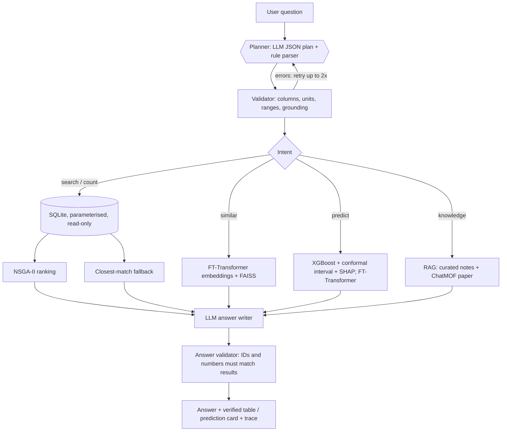

# MOFChat: Explainable, Data-Grounded Metal-Organic Framework Recommendation with Validated LLM Planning, Multi-Objective Optimisation and Surrogate Models

**22AIE452 Data Driven Material Modeling and Simulation · Team 09**
Amrutha T (24255) · Charan Tej Reddy Y (24259) · Poojitha D (24263) · Enku Sai Mohith (24316) · Ramu Jahna Bindu (24249)

## Abstract

Selecting a metal-organic framework (MOF) for a task such as CO2 capture or gas storage means searching thousands of structures on several properties at once. LLM agents such as ChatMOF make this conversational, but they generate code that can fail, exceed token limits or return unchecked answers.

MOFChat is an assistant over the 12,020-MOF CoRE-MOF 2019 table that runs on free cloud language models or fully offline:

- A language model produces a **structured query plan** rather than code. Any of 14 models can be used: free Gemini, Groq and OpenRouter models, or local Llama 3 / Qwen through Ollama. Rate-limited models fall back automatically to the next one, and to a deterministic rule parser if none is reachable.
- A **validator** checks and repairs the plan: units, physical ranges, grounding of numbers and IDs.
- Parameterised **SQL** retrieves exact matches, and **NSGA-II** ranks candidates on several objectives.
- **Surrogate models** (XGBoost, Gaussian process, FT-Transformer) predict properties with **SHAP** explanations and conformal intervals.
- A self-supervised **FT-Transformer** powers similarity search.
- An **answer validator** rejects MOF IDs and numbers that are not in the retrieved data.

On a 64-question labelled development benchmark the final system answers 100 % of questions exactly; the rule parser was tuned on these questions. On 20 held-out phrasings written afterwards it also answers all 20 with the default free model (Gemini 3.1 Flash-Lite), and 80 % fully offline with a local Llama 3 8B, where the validator and hybrid planner add 15 points. Our review-1 design scores 9.4 % and 5 % on the same two sets. Six free models were compared; the four cloud models that completed the run are within one question of each other. The surface-area surrogate reaches R² = 0.982 (MAE 90 m²/g), and its 90 % conformal interval covers 90.5 % of test MOFs.

## 1. Introduction and problem statement

MOFs are crystalline porous materials built from metal nodes and organic linkers. Their tunable pores make them candidates for carbon capture, hydrogen and methane storage, separations and catalysis.

The CoRE-MOF database lists thousands of experimental structures with computed geometric descriptors. Choosing among them requires database queries, several properties at once, and domain knowledge (which pore sizes admit which gases, why open metal sites matter).

The base paper, **ChatMOF** (Kang & Kim, *Nat. Commun.* 15, 4705, 2024), showed that a GPT-4 agent can search, predict and generate MOFs from natural language. Its own analysis reports these limitations:

- token-limit failures on large tables;
- logic errors in LLM-generated code;
- reliance on a proprietary online LLM;
- a dedicated pretrained model needed for every property;
- generated results with no further validation.

**Objectives:**
1. Answer natural-language MOF questions with exact, verifiable results from the full 12,020-MOF table, using free or local models only.
2. Make LLM planning safe and measurable: validation, self-correction and fallback.
3. Rank candidates on multiple objectives (NSGA-II).
4. Predict properties with uncertainty and explanations (surrogates + SHAP).
5. Add literature and domain knowledge (RAG).
6. Evaluate everything quantitatively, including a held-out set.

## 2. Literature review

See [LITERATURE_REVIEW.md](LITERATURE_REVIEW.md). It has fifteen verified papers; six entries of the review-1 table could not be found and were removed.

The key works are:
- ChatMOF (base paper) and MOFTransformer (Kang et al., *Nat. Mach. Intell.* 2023);
- the CoRE MOF 2019 database (Chung et al., *J. Chem. Eng. Data* 2019);
- FT-Transformer (Gorishniy et al., NeurIPS 2021) and the tree-vs-deep-learning study of Grinsztajn et al. (NeurIPS 2022);
- RAG (Lewis et al., 2020) and table RAG / reasoning (TableRAG, Chain-of-Table, TARGET);
- NSGA-II (Deb et al., 2002) and SHAP (Lundberg & Lee, 2017).

## 3. Dataset and preprocessing

**Source.** The CoRE MOF 2019 descriptor table distributed with ChatMOF: 12,020 MOFs × 17 columns. The descriptors are Zeo++ geometry computed with a 3.31 Å (N2) probe, according to the ChatMOF methods section.

**ETL** (`setup_db.py`). Load, normalise headers, rename to a clean schema, and verify data quality with assertions:

| Check | Finding | Action |
|---|---|---|
| Missing values / duplicate rows / duplicate names | none | none |
| "Accessible volume volume fraction" vs "void fraction" | identical | dropped duplicate |
| "Accessible volume (cm³/g)" vs "Accessible pore volume" | identical | dropped duplicate |
| Pore volume vs void fraction / density | equal (max rel. error 6×10⁻⁶) | documented as derived |
| Volumetric vs gravimetric surface area | ASA_vol = ASA × density | documented as derived |
| Zero surface area (3,252 MOFs, 27 %) | all have PLD < 3.31 Å: probe excluded, not missing data | physics rule in models |
| Density unit | header says cm³/g, values are g/cm³ | corrected label |
| Multi-metal MOFs (2,087) | comma-separated metals | normalised `mof_metals` table |

The output is a SQLite database (`data/coremof.db`) with `materials` (15 columns), `mof_metals` and `columns_doc` tables, indexed for the common filters.

## 4. System design

### 4.1 Planner
The planner LLM (temperature 0, JSON mode) receives a schema description, rules and nine few-shot examples. It outputs a plan with these fields:
- intent;
- numeric constraints and objectives;
- metals and open-metal-site flag;
- application and gases;
- MOF IDs;
- aggregate, prediction target and inputs;
- limit.

A deterministic **rule parser** (regular expressions over comparators, ranges, percentages, superlatives, metals, gases and applications) produces the same structure. It is used as the fallback and as a reproducible baseline. The **hybrid** planner adds to the LLM plan the facts the rule parser is certain about: explicit numeric constraints, metals, explicit limits, and applications named by keyword.

**Language models** (`mofchat/llm.py`). The LLM is an interchangeable component behind a registry of 14 models, each reporting whether it is usable right now (key present, package installed, server running):

| Provider | Models | Free-tier limit |
|---|---|---|
| Ollama (local, offline) | Llama 3 8B, Llama 3.1 8B, Qwen 2.5 7B, Nemotron Mini 4B | none (laptop CPU) |
| Google Gemini | 3.5 Flash, 3.8 Flash, 3.1 Flash-Lite, Flash-Lite latest | about 10–15 requests/min |
| Groq | GPT-OSS 120B, GPT-OSS 20B, Qwen 3.8 27B | 8,000 tokens/min, 1,000 requests/day per model |
| OpenRouter | Nemotron 3 Super 120B, Nemotron 3 Ultra 550B, Gemma 4 31B (`:free`) | about 50 requests/day |

Every call goes through one function that throttles each model to its free-tier budget and, on a rate limit or outage (429/503), moves to the next model in the fallback chain. If every model fails, the rule parser plans and a template writes the answer, so a question is always answered. Section 5.2 compares the models.

### 4.2 Validator (`mofchat/validator.py`)
- Resolves column aliases from a single registry (`config.py`).
- Normalises operators, directions and percentages.
- Rejects unknown columns, non-numeric values and LLM-invented impossible values.
- Turns thresholds not present in the question into preferences.
- Drops MOF IDs not mentioned in the question.
- Merges duplicate bounds and flags contradictions.
- Repairs superlatives written as constraints.
- Expands application presets into explicit, explained constraints and objectives.
- For application questions, drops ranking objectives the question does not mention, so the preset (and its explanation) decides the ranking. GPT-OSS 20B, for example, ranked "best MOFs for CO2 capture" by gravimetric surface area, silently replacing the CO2 preset.

Errors go back to the LLM for up to two corrections, after which the rule plan is used.

### 4.3 Executor (`mofchat/tools.py`)
- The plan is compiled into SQL with whitelisted column names and bound parameters, on a read-only connection.
- One objective → plain sort.
- Two or more objectives → **NSGA-II selection** (`optimizer.py`): fast non-dominated sorting (an exact O(n log n) sweep for two objectives, chunked for more) plus crowding distance. Candidates in the worst 25 % of any objective are screened out first.
- No exact match → the closest MOFs, ranked by total constraint violation in robust standard deviations, and the user is told so explicitly.

### 4.4 Application heuristics (`knowledge/applications.md`)

| Application | Constraints / objectives |
|---|---|
| H2 storage | PLD ≥ 2.89 Å; maximise gravimetric surface area and void fraction (Chahine's rule) |
| CH4 storage | PLD ≥ 3.80 Å; maximise volumetric surface area and void fraction |
| CO2 capture | open metal site; PLD ≥ 3.30 Å; maximise volumetric surface area, minimise LCD |
| Size-sieving separation of A/B | d_A ≤ PLD ≤ d_B, from kinetic diameters |
| Catalysis | open metal site; PLD ≥ 5 Å |

These are explicitly heuristics: the dataset has no adsorption data.

### 4.5 FT-Transformer (`mofchat/ft_transformer.py`)
- **Architecture:** follows Gorishniy et al. (2021). Each numeric descriptor x_j becomes a token x_j·W_j + b_j; categorical features (primary metal, open metal site) become embeddings. A [CLS] token is prepended, followed by three pre-norm Transformer blocks (d = 64, 4 heads) that can return attention maps.
- **Self-supervised embedding model** (`train_ft.py`): 30 % of descriptor tokens are replaced by a learned [MASK] token and the [CLS] state must reconstruct all ten descriptors. It uses a 85/15 split, early stopping (38 epochs, 63 s) and has 114k parameters. L2-normalised [CLS] states are indexed with FAISS (inner product = cosine).
- **Regressor:** the same backbone with a linear head, trained on standardised targets.

### 4.6 Surrogate models (`train_property_models.py`)
- **Targets:** accessible surface area (from density, LCD, PLD, LFPD, void fraction, pore volume) and void fraction (from density, LCD, PLD, LFPD; pore volume is excluded because it would leak the target).
- **Split:** 70/10/10/10 for train / validation (early stopping) / calibration (conformal) / test.
- **Models:** mean baseline, Ridge, Gaussian process (RBF-ARD + noise, 2,000-sample subset), XGBoost (main model) and the FT-Transformer regressor.
- **Surface-area physics rule:** PLD below the probe diameter → 0, so the regressors train on accessible MOFs only.
- **Explanations and intervals:** SHAP (TreeExplainer) and split-conformal 90 % intervals.

### 4.7 Knowledge retrieval (`setup_vectorstore.py`)
- **Corpus:** five curated notes with references (dataset definitions and quality facts, kinetic diameters and sieving, application heuristics, MOF basics, MOFChat methods), plus the ChatMOF paper (13 pages, reference list skipped). That gives 104 chunks.
- **Retrieval:** all-MiniLM-L6-v2 normalised embeddings and FAISS inner product. Questions whose best match scores below 0.30 cosine are treated as off-topic.

### 4.8 Answer generation and validation
The LLM writes a short answer from the verified rows (at most 10), a percentile-based "why" per MOF, notes and cited snippets.

The validator then:
1. extracts every ID-like token and number (including thousands written with narrow spaces, "8 318", as GPT-OSS does);
2. corrects IDs within edit distance 2 of a result (e.g. ACOCLUS → ACOCUS);
3. flags unknown IDs and numbers not traceable to the data (within rounding);
4. checks **comparison claims** about named MOFs: in "the remaining three (A, B, C) offer surface areas ≥ 6000 m²/g" each number exists somewhere in the results, so step 3 passes, but the claim is false if B has 4,564 m²/g. The column is found from the unit or the nearest property name, the MOFs from the IDs in the sentence (or "these", "all five"), and each one is checked against the database. Claims about Pareto fronts ("on the first front") are checked against the NSGA-II ranks;
5. regenerates once with the exact problems listed;
6. flags anything still unverified.

The verified table, or for predictions a card with the value, interval and SHAP drivers, is always displayed next to the text.

### 4.9 Application (Streamlit)
Five pages:
- **Chat:** answer, verified table or prediction card, "why it fits", Pareto plot, SHAP, sources, plan/SQL/validator trace, and which model answered. The sidebar picks the language model (or none) and the planner mode.
- **Explore & optimise:** filters and two-objective NSGA-II with Pareto plot.
- **Predict & explain:** prediction, interval, SHAP and FT attention.
- **Evaluation:** all metrics and figures.
- **About.**

The app works without any language model, falling back to rule-based planning and template answers.

## 5. Experiments and results

All numbers are generated by the scripts. Full tables and figures are in [RESULTS.md](RESULTS.md).

### 5.1 Retrieval benchmark
- **Development set:** 64 labelled questions in 10 categories (single/multiple constraints, metal/open-metal-site, superlatives, multi-objective, applications, count/average, lookup/similarity, impossible requests, knowledge/off-topic).
- **Held-out set:** 20 new phrasings written after the rule parser had been tuned, never used for tuning.
- **Gold answers:** gold plans executed by the same executor, which is unit-tested against pandas.

The LLM rows use **Gemini 3.1 Flash-Lite**, the best model in the comparison of section 5.2; the local Llama 3 rows are shown for contrast.

| System | Development set (64) exact | Held-out set (20) exact | Held-out constraint precision@k |
|---|---:|---:|---:|
| Review-1 two-tower (shipped) | 9.4 % | 5.0 % | 41.8 % |
| Rules planner (no LLM) | 100.0 % | 80.0 % | 72.7 % |
| Gemini 3.1 Flash-Lite, single shot (no validator) | 100.0 % | 100.0 % | 100.0 % |
| Gemini 3.1 Flash-Lite + validator | 100.0 % | 100.0 % | 100.0 % |
| **Hybrid with Gemini 3.1 Flash-Lite (default)** | **100.0 %** | **100.0 %** | **100.0 %** |
| Llama 3 8B (local), single shot | 85.9 % | 65.0 % | - |
| Llama 3 8B + validator | 93.8 % | 70.0 % | - |
| Hybrid with Llama 3 8B | 100.0 % | 80.0 % | - |

How to read this:
- **Development set.** The rule parser was written while looking at these questions, so its 100 % is optimistic; the held-out set is the honest estimate.
- **Held-out set.** With the default model the system answers all 20 new phrasings exactly; the review-1 design manages 5 %, and the rule parser alone 80 %. Twenty questions is a small set: one question is 5 points.
- **Where the safety layers matter.** For a strong model they change nothing (100 → 100 → 100 %) and cost under 0.01 s. For the small local model they are what makes it usable: Llama 3 rises from 65 % alone to 70 % with the validator and 80 % with the hybrid merge on held-out questions (85.9 → 93.8 → 100 % on the development set). The validator is therefore the reason MOFChat still works offline.
- **Remaining held-out errors (Llama 3).** It maps "natural gas" storage and an H2/CH4 sieving question to the hydrogen-storage preset, adds an extra objective to one question, and answers "Is there any MOF with density above 8 g/cm³?" with a count (0) instead of a search.
- **Context.** ChatMOF reports 96.9 % on its own search questions with GPT-4; the question sets differ.

### 5.2 Which free language model? (model comparison)
Each model planned both question sets on its own, with fallback switched off so every score belongs to one model. OpenRouter's free tier allows about 50 requests a day, so Nemotron was tested on the held-out set only.

| Model | Held-out: LLM alone | Held-out: hybrid | Development: hybrid | Median time per planning call | Provider errors |
|---|---:|---:|---:|---:|---:|
| **Gemini 3.1 Flash-Lite** (default) | 100 % | 100 % | 100 % | 1.5 s (10.6 s under load) | 13 of 84 |
| GPT-OSS 120B (Groq) | 95 % | 95 % | 100 % | 2.4–4.7 s | 0 |
| Qwen 3.8 27B (Groq) | 95 % | 95 % | 100 % | 20 s | 0 |
| Nemotron 3 Super 120B (OpenRouter) | 95 % | 95 % | - | 2.0 s | 0 |
| Llama 3 8B (local, offline) | 65 % | 80 % | 100 % | 1.5 s | 0 |
| Gemini 3.5 Flash | - | - | - | - | 64 of 84 (daily quota used up) |

- **The four cloud models are effectively tied.** GPT-OSS 120B, Qwen 3.8 and Nemotron each miss only the density-above-8 question, which they answer with a count of 0, arguably correct. Flash-Lite plans that one as a search, as the gold plan does.
- **Reliability and speed differ more than accuracy.** Flash-Lite's 13 provider errors and slow development run came from Google's free tier being overloaded at the time (1.5 s per call later). Qwen 3.8 is a reasoning model and spends Groq's 8,000-tokens-per-minute budget quickly, so its median call takes 20 s.
- **Gemini 3.5 Flash could not be compared.** Its free daily quota ran out during the run (429 RESOURCE_EXHAUSTED), so 64 of 84 calls failed and its scores would measure the rule-parser fallback. It is reported as missing, not as a score.
- **Choice.** The app's default order is Gemini 3.1 Flash-Lite (best held-out score), then GPT-OSS 120B (no provider errors, a different provider), Qwen 3.8, and local Llama 3. A rate-limited model falls back to the next one automatically.

### 5.3 Answer validation
Each model wrote full answers to the same 16 questions (search, multi-objective, application, count, lookup and similarity). The validator checked every first draft, requested one rewrite when needed, and flagged anything still wrong.

| Model | First drafts with a problem | Rewritten | Still flagged | LLM call failed | Seconds per answer |
|---|---:|---:|---:|---:|---:|
| **Gemini 3.1 Flash-Lite** (default) | 0 of 16 | 0 | 0 | 0 | 9.9 |
| Llama 3 8B (local) | 2 of 16 | 1 | 0 | 0 | 9.3 |
| GPT-OSS 120B (Groq) | 2 of 16 | 2 | 1 | 0 | 30.2 |
| Qwen 3.8 27B (Groq) | 0 of 16 | 0 | 0 | 7 | 26.4 |

- **What was caught.** Llama 3 invented three numbers in one draft (two densities and a "90 %") and garbled an ID (OFEUN06 → OFERUN06, corrected automatically). GPT-OSS 120B used an unsupported number in one draft; its rewrite then claimed two MOFs were on "Pareto front 1" when the NSGA-II ranks put them on front 2. The new claim check flagged it, so that answer is shown with a warning above the verified table. In an earlier run the same false Pareto claim appeared in a first draft.
- **Failures.** Seven of Qwen 3.8's answer calls failed at Groq's free-tier limits (a reasoning model uses many tokens); a template answer was shown instead, so the user still got the verified result. The long times for the Groq models include waiting for the tokens-per-minute budget.
- **Default model.** Gemini 3.1 Flash-Lite produced no draft that needed correction.

During development the validator's own false positives were found and fixed: percentages taken from the "why" column, plural words such as NOTES, and comma-formatted numbers such as 12,020. The garbled-ID failure observed with the review-1 SQL prototype (ACOCLUS for ACOCUS) is reproduced in a unit test, and the validator corrects it automatically.

### 5.4 Property prediction (held-out 10 % test split)

| Target | Model | MAE | RMSE | R² |
|---|---|---:|---:|---:|
| Surface area (m²/g) | Mean baseline | 609.7 | 915.5 | 0.343 |
| | Ridge | 157.8 | 261.0 | 0.947 |
| | Gaussian process (2k subset) | 97.8 | 170.9 | 0.977 |
| | **XGBoost** | **90.0** | **152.3** | **0.982** |
| | XGBoost without physics rule | 91.4 | 149.6 | 0.983 |
| | FT-Transformer | 92.5 | 153.7 | 0.982 |
| Void fraction | Mean baseline | 0.096 | 0.119 | 0.000 |
| | Ridge | 0.044 | 0.056 | 0.780 |
| | Gaussian process | 0.041 | 0.054 | 0.796 |
| | **XGBoost** | **0.037** | **0.049** | **0.828** |
| | FT-Transformer | 0.039 | 0.050 | 0.823 |

- Conformal 90 % interval coverage on test: 90.5 % (surface area) and 88.4 % (void fraction). GPR 95 % coverage: 93.9 % and 95.1 %.
- The physics rule is 100 % accurate on test. It does not improve accuracy (XGBoost learns it), but it makes zero predictions exact and explainable.
- SHAP: pore volume and void fraction dominate the surface-area predictions, and density dominates void fraction, which is physically sensible.
- The FT-Transformer ties XGBoost on surface area, consistent with Grinsztajn et al.

### 5.5 Embedding similarity
- FT-Transformer neighbours differ from the query by 0.077 σ per descriptor, against 0.068 σ for direct k-NN on the descriptors (an upper bound on this metric) and 0.95 σ for random MOFs.
- They share the query's primary metal more often than k-NN neighbours (27.8 % vs 22.8 %; random 8 %), because metal and open-metal-site are input tokens.
- Overlap with the k-NN neighbour lists is 62 %.

### 5.6 Knowledge retrieval
On 12 in-domain questions with a known source, hit@1 is 75 % and hit@3 is 83 %. All 5 off-topic questions are rejected.

### 5.7 Classification, learning curves and feature extraction (`evaluate_dl.py`)
Full tables and figures are in [DL_RESULTS.md](DL_RESULTS.md); the production models are not changed by this script.

**Open-metal-site (OMS) classification.** This is a new deep-learning classification experiment on a real database label: 66.4 % of MOFs have an open metal site.
- **Inputs:** the ten geometric descriptors plus the primary metal. OMS_Type is excluded because it would give the answer away.
- **Split:** stratified 8,414 / 1,803 / 1,803 (train / validation / test).

| Model | Accuracy | F1 | ROC-AUC | PR-AUC | Train / val / test accuracy |
|---|---:|---:|---:|---:|---|
| Majority baseline | 0.663 | 0.798 | 0.500 | 0.663 | - |
| Logistic regression | 0.693 | 0.798 | 0.676 | 0.804 | 0.705 / 0.699 / 0.693 |
| XGBoost | 0.750 | 0.827 | 0.787 | 0.871 | 0.868 / 0.770 / 0.750 |
| MLP (deep learning) | 0.734 | 0.814 | 0.756 | 0.847 | 0.782 / 0.755 / 0.734 |
| FT-Transformer (deep learning, 104k parameters) | 0.728 | 0.810 | 0.755 | 0.852 | 0.781 / 0.735 / 0.728 |

- All learned classifiers beat the baseline. XGBoost is best, and the two deep models are close behind, the same pattern as the regression results.
- Accuracy levels off near 75 %. Our interpretation: whether a metal site is open depends on coordination chemistry that pore geometry and metal type only partly capture.
- The report also includes confusion matrices, ROC and precision-recall curves, and per-epoch train/validation loss and accuracy curves.

**Intent classification by the planner** (84 benchmark questions, from the saved plans):
- the hybrid planner reaches 0.988 intent accuracy with both Gemini 3.1 Flash-Lite and Llama 3;
- Llama 3 alone reaches 0.893;
- the rule parser alone reaches 0.964.

**Off-topic detection.** The top cosine score of the knowledge retriever separates 91 MOF questions from 20 off-topic ones with ROC-AUC 0.981 (accuracy 0.955 at the fixed 0.30 threshold).

**Regression, train / validation / test R²** (XGBoost, MOFs with accessible pores):
- surface area: 0.987 / 0.959 / 0.972;
- void fraction: 0.899 / 0.820 / 0.828.

The FT-Transformer learning curves (loss and R² per epoch) and the XGBoost RMSE per boosting round show where early stopping picks each model.

**Feature extraction:**
- descriptor distributions and correlations (strongest: LCD–LFPD +0.99);
- PCA (two components explain 78 % of the variance);
- t-SNE of the 64-d FT-Transformer embeddings;
- masked-reconstruction R² per descriptor;
- SHAP importance.

## 6. Discussion

- **Why the review-1 retrieval failed.** It searched an FT-autoencoder index with a Sentence-BERT question vector. The vectors had the same dimension but no shared training, so retrieval ignored the question (the "chocolate cake" test). The general lesson: a two-tower model needs paired training data, and constraint satisfaction over numbers is a database problem, not a similarity problem.
- **LLM vs rules.** The rule parser is fast and exact on phrasings it knows, but brittle on new ones ("tops 5500", "lighter than 0.4"). A small LLM generalises better but makes systematic schema errors, such as superlatives as constraints or confusing methane with hydrogen. Validation, self-correction and the hybrid merge combine their strengths; the single-shot vs validated vs hybrid rows quantify each step.
- **Small local model vs free cloud models.** A free cloud model (Gemini 3.1 Flash-Lite, GPT-OSS 120B, Qwen 3.8, Nemotron) plans almost every question correctly on its own, so the benchmark no longer separates them; their real differences are free-tier reliability and speed. The safety layers earn their place with the local 8B model, where they add 15 points on held-out questions, and as insurance against a cloud model's off days.
- **Testing the finished app found what the benchmark could not.** The benchmark scores plans, not the written text, so four bugs only appeared when we used the app with GPT-OSS 20B: a false "≥ 6000 m²/g" claim that passed the number check, application presets silently replaced by the LLM's own objectives, a prediction the model refused to state after a validator false positive on "90 %", and thousands written with narrow spaces ("8 318") read as two numbers. Each is fixed and has a unit test built from the real output; the evaluation was re-run afterwards.
- **Deep learning vs trees.** On about 8,000 accessible MOFs with 6 features, XGBoost and the FT-Transformer are statistically tied. XGBoost trains 400× faster (0.25 s vs 112 s) and gives exact TreeSHAP explanations, so it is the production model and the FT-Transformer a second opinion.

## 7. Limitations and future work
- No gas-uptake or selectivity labels locally. Attaching GCMC data for CoRE/hMOF MOFs would let the same surrogate pipeline predict uptakes directly; the hMOF folder already holds the structures and energy grids.
- No structure generation.
- Application presets are heuristics.
- The local Llama 3 8B still mis-plans some held-out phrasings (80 % with the hybrid); LoRA fine-tuning on plan examples would help the offline mode. Free cloud tiers have daily quotas and overload periods, which the fallback chain absorbs but cannot remove.
- The answer validator checks MOF IDs, numbers and comparison claims, not free-text reasoning: a small model can still write a wrong formula or definition in a sentence without numbers. The knowledge sources are shown so the user can check.
- Similarity search could add structure-based embeddings (e.g. MOFTransformer) for chemistry-aware neighbours.

## 8. Conclusion
MOFChat turns the ChatMOF idea into a validated and measurable system that runs on free cloud models or fully offline:
- exact answers over all 12,020 MOFs;
- multi-objective ranking with NSGA-II;
- calibrated, explained property predictions;
- literature grounding;
- an answer validator that keeps the LLM honest.

Every claim in this report is backed by a script in the repository and by the benchmark.

## References
See [LITERATURE_REVIEW.md](LITERATURE_REVIEW.md) for the full verified list.
