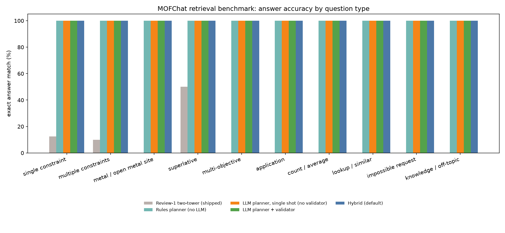
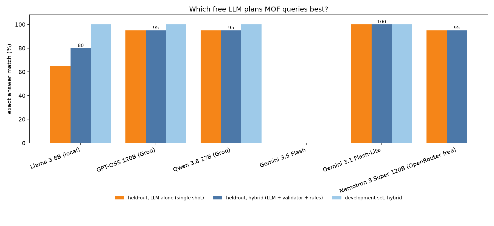
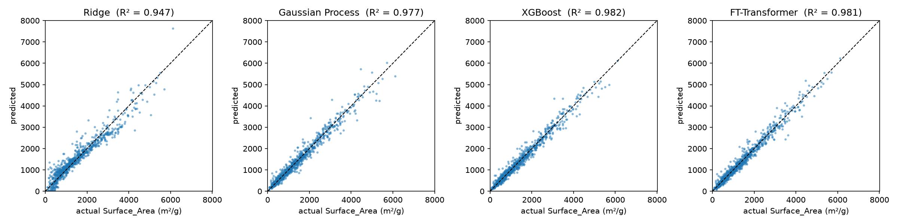
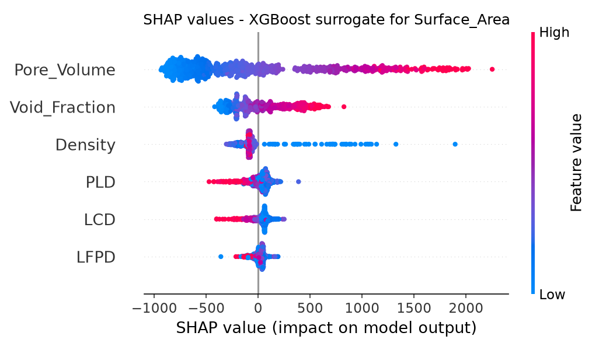
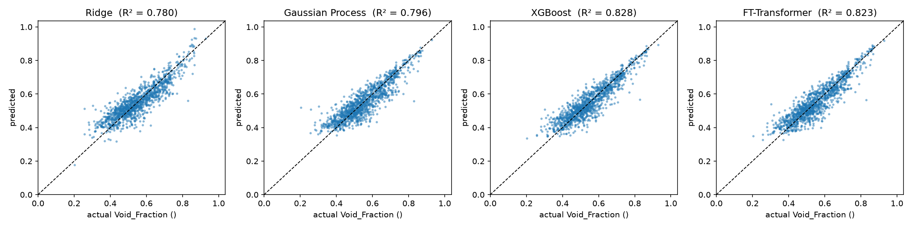
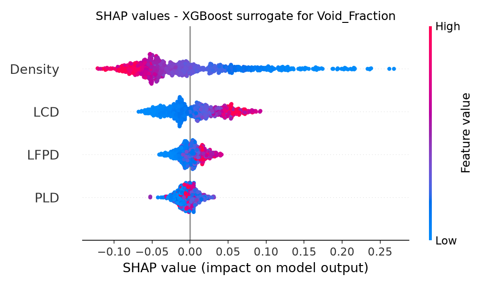

# MOFChat - results

_Generated by `python evaluate.py` on 2026-10-08 23:17; model summary recomputed from the saved results on 2026-10-08 23:41; answer validation re-run on 2026-10-08 23:38; knowledge retrieval re-run on 2026-10-08 23:41. Numbers are copied from `artifacts/` - do not edit by hand._

## 1. Retrieval benchmark (64 labelled questions, 10 categories)

A system is counted correct only if it returns exactly the MOFs (or the count/average) that the hand-written gold plan returns from the database.

| System | Exact answer match | Constraint precision@k | Plan accuracy | Planning latency* |
|---|---:|---:|---:|---:|
| Review-1 two-tower (shipped) | 9.4% | 30.3% | - | 0.01 s |
| Rules planner (no LLM) | 100.0% | 100.0% | 100.0% | 0.01 s |
| LLM planner, single shot (no validator) | 100.0% | 100.0% | 100.0% | 1.47 s |
| LLM planner + validator | 100.0% | 100.0% | 100.0% | 1.47 s |
| Hybrid (default) | 100.0% | 100.0% | 100.0% | 1.47 s |

\* LLM rows: median time of one Gemini 3.1 Flash-Lite planning call on the held-out run of the model comparison (the plans are cached and reused across the three LLM systems, temperature 0; the median leaves out free-tier rate-limit waits). Validation and the hybrid merge add under 0.01 s. The full answer (planning + retrieval + answer writing + validation) is timed in section 2.

Exact answer match by question type (%):

| Category | Review-1 two-tower (shipped) | Rules planner (no LLM) | LLM planner, single shot (no validator) | LLM planner + validator | Hybrid (default) |
|---|---:|---:|---:|---:|---:|
| single constraint | 12.5 | 100.0 | 100.0 | 100.0 | 100.0 |
| multiple constraints | 10.0 | 100.0 | 100.0 | 100.0 | 100.0 |
| metal / open metal site | 0.0 | 100.0 | 100.0 | 100.0 | 100.0 |
| superlative | 50.0 | 100.0 | 100.0 | 100.0 | 100.0 |
| multi-objective | 0.0 | 100.0 | 100.0 | 100.0 | 100.0 |
| application | 0.0 | 100.0 | 100.0 | 100.0 | 100.0 |
| count / average | 0.0 | 100.0 | 100.0 | 100.0 | 100.0 |
| lookup / similar | 0.0 | 100.0 | 100.0 | 100.0 | 100.0 |
| impossible request | 0.0 | 100.0 | 100.0 | 100.0 | 100.0 |
| knowledge / off-topic | 0.0 | 100.0 | 100.0 | 100.0 | 100.0 |

**Held-out set** (20 new phrasings written after the rule parser was tuned on the development set, and never used for tuning):

| System | Exact answer match | Constraint precision@k | Plan accuracy |
|---|---:|---:|---:|
| Review-1 two-tower (shipped) | 5.0% | 41.8% | - |
| Rules planner (no LLM) | 80.0% | 72.7% | 80.0% |
| LLM planner, single shot (no validator) | 100.0% | 100.0% | 100.0% |
| LLM planner + validator | 100.0% | 100.0% | 100.0% |
| Hybrid (default) | 100.0% | 100.0% | 100.0% |

For context, ChatMOF (GPT-4) reports 96.9 % accuracy on its own 100 search questions (excluding token-limit failures); the question sets differ, so the numbers are not directly comparable.

## 1b. Which free LLM is best? (model comparison)

Each model is tested on its own, with automatic fallback switched off. OpenRouter free accounts allow about 50 requests per day, so the OpenRouter model was tested on the held-out set only. The main tables above use **Gemini 3.1 Flash-Lite**, the best model on the held-out set.

| Model | Provider | Held-out: LLM alone | Held-out: hybrid | Development: LLM alone | Development: hybrid | Median planning time per call (dev / held-out) | Provider errors* |
|---|---|---:|---:|---:|---:|---:|---:|
| Llama 3 8B (local) | Ollama (local, offline) | 65.0% | 80.0% | 85.9% | 100.0% | 1.45 / 1.46 s | 0 |
| GPT-OSS 120B (Groq) | Groq (free tier) | 95.0% | 95.0% | 100.0% | 100.0% | 2.4 / 4.69 s | 0 |
| Qwen 3.8 27B (Groq) | Groq (free tier) | 95.0% | 95.0% | 100.0% | 100.0% | 20.04 / 20.26 s | 0 |
| Gemini 3.5 Flash † | Google Gemini (free tier) | - | - | - | - | - / - | 64 |
| Gemini 3.1 Flash-Lite **(default)** | Google Gemini (free tier) | 100.0% | 100.0% | 79.7% (100.0% of the 51 answered) | 100.0% | 10.62 / 1.47 s | 13 |
| Nemotron 3 Super 120B (OpenRouter free) | OpenRouter (free models) | 95.0% | 95.0% | - | - | - / 1.96 s | 0 |

\* Requests that failed at the provider (rate limit, overload, outage). In the app, these fall back to the next model automatically. Free-tier latency also depends on provider load at the time of the run, so the two medians can differ a lot for the same model.

† The model's free daily quota ran out during the run (429 RESOURCE_EXHAUSTED), so most planning calls failed and its scores would measure the rule-parser fallback, not the model; they are left out (\-) and the model is not considered for the default.

Answer writing (16 questions per model, checked by the answer validator):

| Model | LLM call failed (template used) | First drafts with any problem | of which false comparison claims | Regenerated | Still flagged | Seconds per full answer |
|---|---:|---:|---:|---:|---:|---:|
| Llama 3 8B (local) | 0 | 2 of 16 | 0 | 1 | 0 | 9.3 |
| GPT-OSS 120B (Groq) | 0 | 2 of 16 | 0 | 2 | 1 | 30.2 |
| Qwen 3.8 27B (Groq) | 7 | 0 of 16 | 0 | 0 | 0 | 26.4 |
| Gemini 3.1 Flash-Lite | 0 | 0 of 16 | 0 | 0 | 0 | 9.9 |

## 2. Answer validation (hallucination check)

- Gemini 3.1 Flash-Lite answers generated: 16
- First drafts with at least one problem: 0 (0 with wrong/garbled IDs, 0 with unverified numbers, 0 with false comparison claims such as "A, B and C have surface areas >= 6000 m²/g" when B has less)
- Answers regenerated after validator feedback: 0
- Final answers still carrying a validator warning: 0
- Mean time per full answer: 9.9 s

## 3. Knowledge retrieval (RAG)

- hit@1 75%, hit@3 83% on 12 questions with a known source
- In-domain questions accepted: 92%; off-topic questions rejected: 100% (cosine threshold 0.3)

## 4. Property prediction (held-out 10 % test split)

**Surface_Area** (m²/g) from Density, LCD, PLD, LFPD, Void_Fraction, Pore_Volume

| Model | MAE | RMSE | R² |
|---|---:|---:|---:|
| Mean baseline | 609.7 | 915.5 | 0.3429 |
| Ridge | 157.8 | 261 | 0.9466 |
| Gaussian Process | 97.76 | 170.9 | 0.9771 |
| XGBoost | 89.95 | 152.3 | 0.9818 |
| XGBoost (no physics rule) | 91.39 | 149.6 | 0.9825 |
| FT-Transformer | 92.55 | 153.7 | 0.9815 |

- Split-conformal 90 % interval: ±287.7, test coverage 90.5%; GPR 95 % interval coverage 93.9%
- Physics rule `Surface_Area = 0 if PLD < 3.3107 A`: accuracy 100.00% on test
- Mean |SHAP| (XGBoost): Pore_Volume 628, Void_Fraction 235, Density 139, PLD 73.4, LCD 71, LFPD 38.6

**Void_Fraction** (dimensionless) from Density, LCD, PLD, LFPD

| Model | MAE | RMSE | R² |
|---|---:|---:|---:|
| Mean baseline | 0.09647 | 0.1189 | -0.0001 |
| Ridge | 0.04365 | 0.05583 | 0.7796 |
| Gaussian Process | 0.041 | 0.05367 | 0.7964 |
| XGBoost | 0.0373 | 0.04937 | 0.8277 |
| FT-Transformer | 0.03889 | 0.05011 | 0.8225 |

- Split-conformal 90 % interval: ±0.07814, test coverage 88.4%; GPR 95 % interval coverage 95.1%
- Mean |SHAP| (XGBoost): Density 0.0567, LCD 0.029, LFPD 0.0115, PLD 0.00937

## 5. FT-Transformer embeddings (similarity search)

Masked-descriptor autoencoder, 114,378 parameters, 38 epochs (63.3 s). 1000 random query MOFs, 10 neighbours each:

| Neighbours from | Mean descriptor difference (σ) | Same metal | Same open-metal-site flag |
|---|---:|---:|---:|
| ft embedding | 0.077 | 27.8% | 70.2% |
| raw descriptor knn | 0.068 | 22.8% | 66.4% |
| random | 0.952 | 8.0% | 55.7% |

Overlap of FT-Transformer and raw-descriptor neighbour lists: 62%.
Raw k-NN optimises exactly the descriptor-difference metric, so it is an upper bound on that column; the FT embedding is close to it while matching metal and open-metal-site more often, because those categorical tokens are part of its input.
