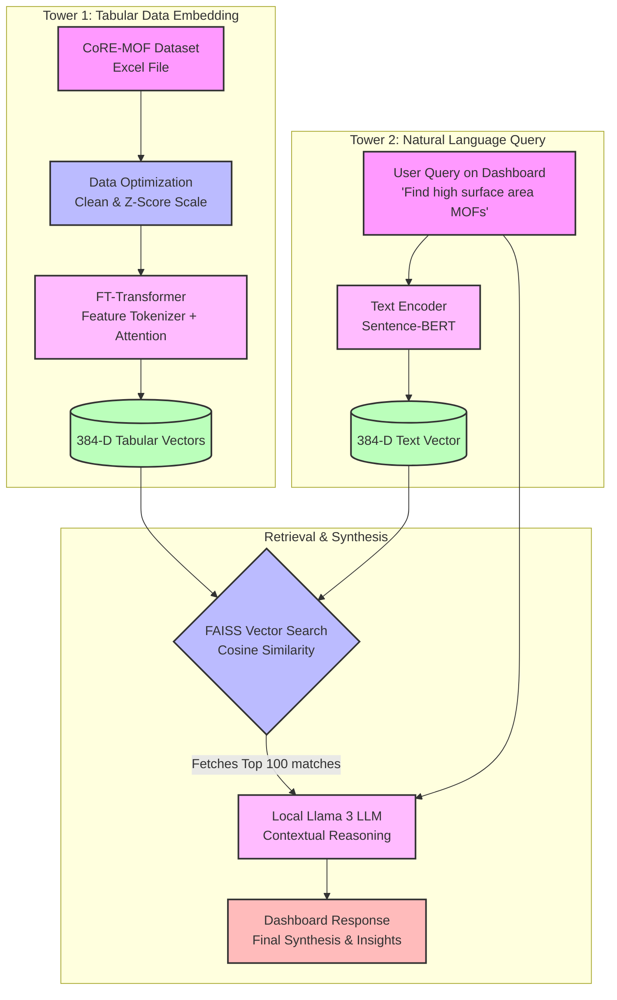

> **Superseded (October 2026).** This document describes the review-1 design, in which the user's question was embedded with Sentence-BERT and searched directly in the FT-Transformer index. The two towers were never trained to align, and testing showed the retrieval ignores the question: it returned 9.4 % exact answers on the 64-question benchmark, and a 'chocolate cake' query returned the same MOFs as 'surface area > 4000'. The current system and an up-to-date viva guide are described in `../../docs/` (PROJECT_REPORT.md, VIVA_GUIDE.md, RESULTS.md).

# Project Workflow Flowchart

Here is the visual representation of your project's workflow from the raw dataset to the final user dashboard. You can include this flowchart in your presentation or report.

### Flowchart Breakdown:
1. **Tower 1 (Left Side):** Your offline pipeline. The raw Excel data is cleaned, scaled, and passed through the custom **FT-Transformer** to generate mathematical embeddings of the MOFs.
2. **Tower 2 (Right Side):** Your online pipeline. A user asks a question, and **Sentence-BERT** converts the sentence into an embedding of the exact same size.
3. **Retrieval & Synthesis (Bottom):** **FAISS** instantly compares the vectors to find the closest matches. Those matches are fed into **Llama 3** to generate the final smart response.
